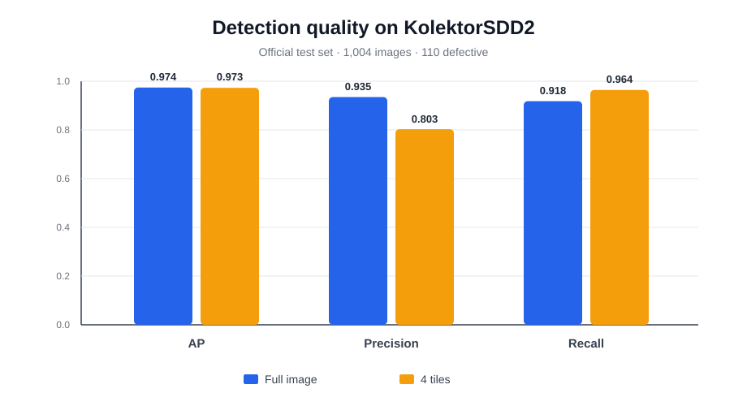
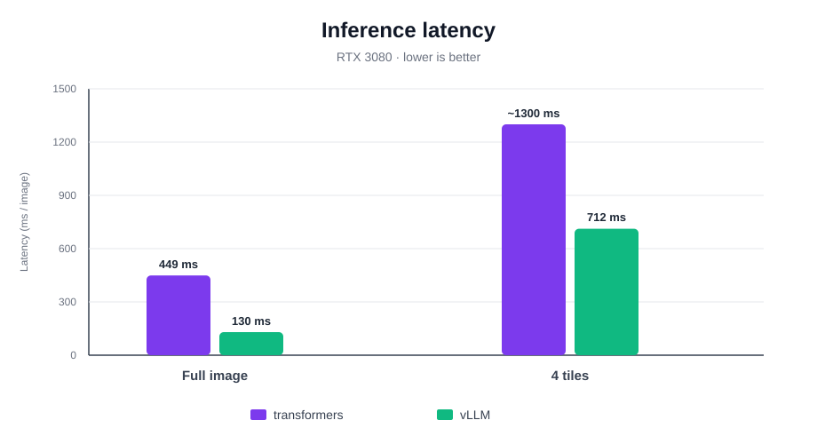
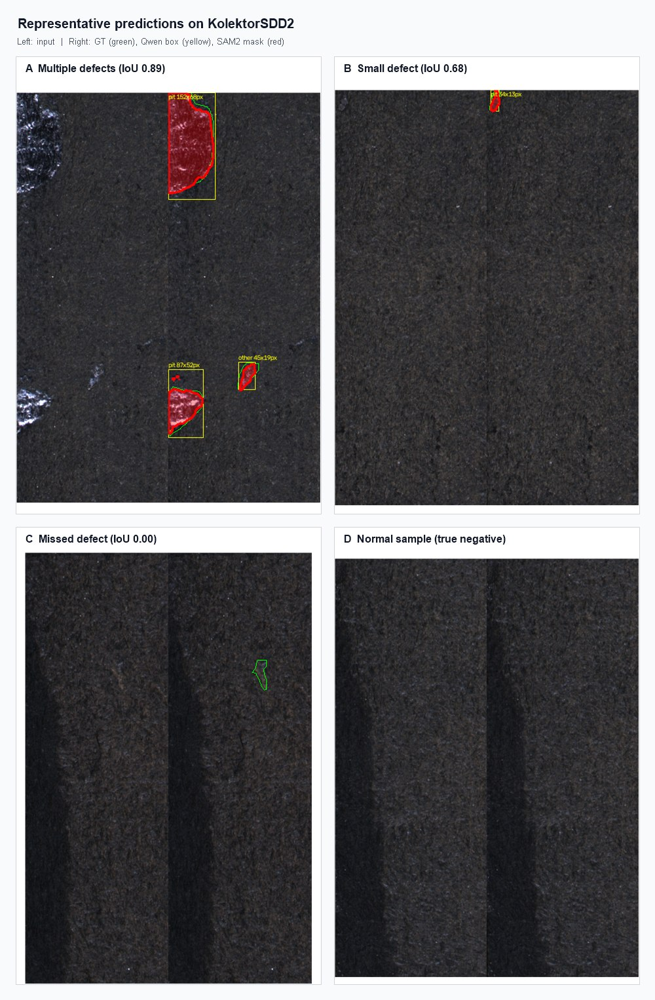

# 以 VLM 進行金屬表面缺陷檢測

以 LoRA 微調 Qwen3-VL，只用 209 張缺陷影像的框標註訓練，在 [KolektorSDD2](https://datasetninja.com/kolektor-surface-defect-dataset-2) 上判斷影像有沒有缺陷並標出位置，再用 SAM2 切出缺陷遮罩，並比較 transformers 與 vLLM 兩種推論方式的速度。

## 與傳統模型比較

KolektorSDD2 官方 test set（1004 張，其中 110 張有缺陷），RTX 3080。

| Method | Model | Input | Backend | Annotation | AP | Precision | Recall | Latency (ms) |
|:---|:---|:---|:---|:---|---:|---:|---:|---:|
| Božič et al. [1] | Two-stage CNN | full image | — | 246 masks | 0.954 | — | — | ~12 |
| DSR [2] | Reconstruction-based | full image | — | 246 masks | 0.952 | — | — | ~17 |
| Ours | Qwen3-VL + LoRA | full image | transformers | 209 boxes | 0.974 | 0.935 | 0.918 | 449 |
| Ours | Qwen3-VL + LoRA | full image | vLLM | 209 boxes | 0.974 | 0.935 | 0.918 | 130 |
| Ours | Qwen3-VL + LoRA | 4 tiles | transformers | 209 boxes | 0.973 | 0.803 | 0.964 | ~1300 |
| Ours | Qwen3-VL + LoRA | 4 tiles | vLLM | 209 boxes | 0.973 | 0.803 | 0.964 | 712 |

### 定量結果

  
  

完整影像推論具有較高的 Precision；四分塊推論則提升 Recall，適合優先降低漏檢的情境。相同輸入策略下，vLLM 將完整影像的平均延遲由 449 ms 降至 130 ms（約 **3.45×** 加速），四分塊推論則由約 1300 ms 降至 712 ms（約 **1.83×** 加速）。

### 定性結果

  

每個案例左側為輸入影像，右側為模型輸出；綠線是 Ground Truth，黃框是 Qwen3-VL 預測框，紅色區域／輪廓是 SAM2 分割結果。圖中同時呈現多缺陷、微小缺陷、漏檢與正常樣本，避免只展示成功案例。漏檢案例也說明目前方法對低對比、細微瑕疵仍有改善空間。

## 參考資料

[1] J. Božič, D. Tabernik, D. Skočaj. *Mixed supervision for surface-defect detection: from weakly to fully supervised learning.* [arXiv:2104.06064](https://arxiv.org/abs/2104.06064)

[2] V. Zavrtanik, M. Kristan, D. Skočaj. *DSR – A dual subspace re-projection network for surface anomaly detection.* [arXiv:2208.01521](https://arxiv.org/abs/2208.01521)
